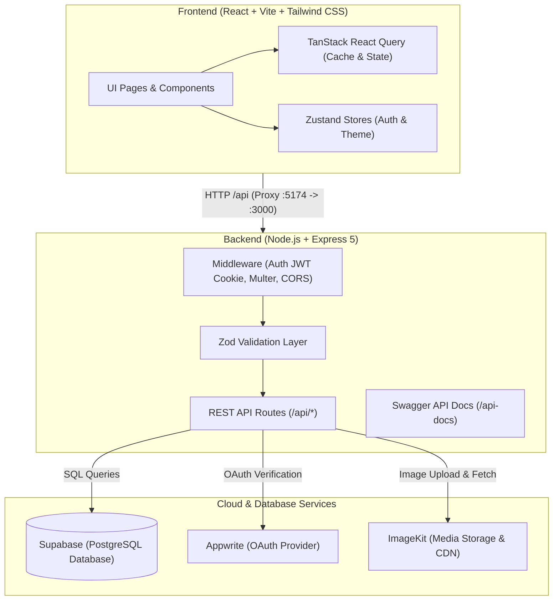
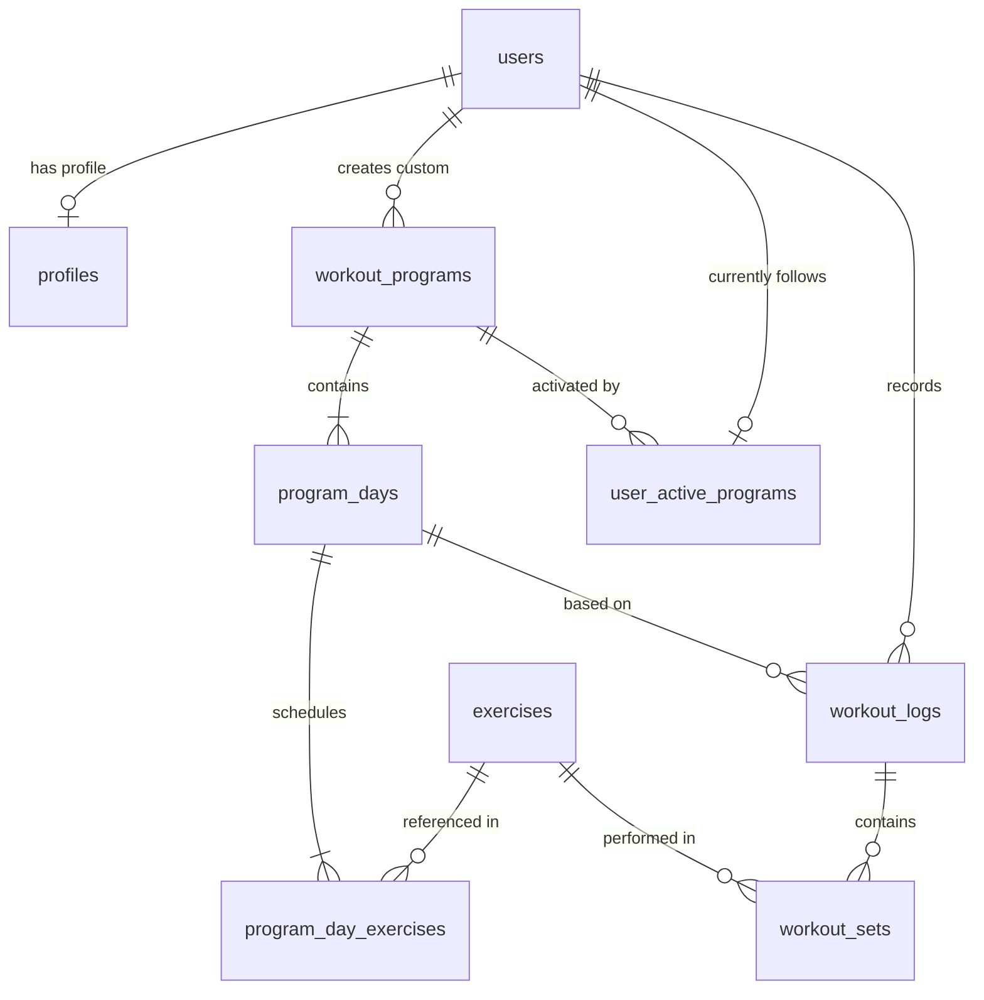

<div align="center">

# 🏋️‍♂️ Liftly

**Your modern, full-stack workout tracking and program management platform.**

Built for gym-goers, athletes, and fitness enthusiasts to design custom training routines, log live workout sets, explore an extensive exercise library, and track progressive overload seamlessly.

[](https://reactjs.org/)
[](https://vitejs.dev/)
[](https://tailwindcss.com/)
[](https://nodejs.org/)
[](https://expressjs.com/)
[](https://supabase.com/)
[](http://localhost:3000/api-docs)

</div>

---

## 📌 Table of Contents

- [Overview](#-overview)
- [Key Features](#-key-features)
- [Tech Stack](#-tech-stack)
- [System Architecture](#-system-architecture)
- [Database Design & Normalization](#-database-design--normalization)
- [API Documentation](#-api-documentation)
- [Project Structure](#-project-structure)
- [Getting Started](#-getting-started)
  - [Prerequisites](#prerequisites)
  - [Backend Setup](#1-backend-setup)
  - [Frontend Setup](#2-frontend-setup)
- [Environment Variables](#-environment-variables)
- [Team Details](#-team-details)
- [License](#-license)

---

## 🚀 Overview

**Liftly** is a high-performance web platform crafted to make strength training tracking fast, clean, and intuitive. Whether you follow a structured Push-Pull-Legs (PPL) split, an Upper/Lower routine, or a customized lifting program, Liftly calculates your scheduled day, tracks your active session with real-time timers and RPE metrics, and stores your complete workout history.

### Why Liftly?
- **Zero Friction Logging:** Log weights, reps, and RPE set-by-set in seconds without clunky interfaces.
- **Dynamic Progression:** Automatically calculates which day of your active program you are on based on elapsed time.
- **Visual Exercises:** Browse dozens of exercises with animated GIF demonstrations and muscle group tags powered by ImageKit CDN.
- **Modern Responsive Design:** Full dark/light mode toggle with smooth, mobile-friendly navigation.

---

## ✨ Key Features

| Feature | Description |
|---|---|
| 📅 **Smart Program Management** | Browse preset default programs or design custom multi-day programs with specific target sets, reps, and rest timers. Activate any program with one click. |
| ⏱️ **Live Workout Session Logger** | Track real-time workouts with automated session duration, set-by-set weight (kg), reps, RPE (Rate of Perceived Exertion), and workout notes. |
| 📖 **Rich Exercise Library** | Filter and search exercises by body part, target muscle, and equipment. Interactive modal with animated GIF/image demonstrations. |
| ➕ **Custom Exercise Creator** | Upload new exercises with media images and GIFs directly via ImageKit CDN integration and Multer processing. |
| 📊 **Athlete Dashboard** | Personalized dashboard displaying **Today's Workout**, total recorded sessions, previous workout recap, and quick-start actions. |
| 📜 **Workout History & Deep Dives** | Chronological record of completed sessions with set breakdowns, volume details, and quick deletion controls. |
| 🔐 **Dual Authentication & Onboarding** | Secure credentials-based authentication with HTTP-only JWT cookies or one-click Google OAuth via Appwrite, complete with a personalized athlete profile onboarding flow. |
| 🌓 **Dark / Light Theme** | Persistent theme system powered by Zustand and Tailwind CSS v4. |
| 📑 **Interactive OpenAPI / Swagger** | Interactive API testing documentation accessible at `/api-docs`. |

---

## 🛠 Tech Stack

### Frontend
- **Framework:** [React 18](https://react.dev/) + [Vite](https://vitejs.dev/)
- **Styling:** [Tailwind CSS v4](https://tailwindcss.com/)
- **State Management:** [Zustand](https://github.com/pmndrs/zustand) (Auth & Theme persistence)
- **Data Fetching & Caching:** [TanStack React Query v5](https://tanstack.com/query/latest)
- **Routing:** [React Router v7](https://reactrouter.com/)
- **Icons & UI:** [Lucide React](https://lucide.dev/)
- **HTTP Client:** [Axios](https://axios-http.com/)

### Backend
- **Runtime:** [Node.js](https://nodejs.org/) (v18+)
- **Framework:** [Express.js 5](https://expressjs.com/)
- **Database:** [PostgreSQL](https://www.postgresql.org/) managed via [Supabase](https://supabase.com/)
- **Authentication:** JWT (JSON Web Tokens), `cookie-parser`, `bcrypt`
- **OAuth:** [Appwrite](https://appwrite.io/) Account & OAuth Session Integration
- **Schema Validation:** [Zod](https://zod.dev/)
- **Media Upload & CDN:** [ImageKit SDK](https://imagekit.io/) + [Multer](https://github.com/expressjs/multer)
- **API Documentation:** [Swagger UI Express](https://github.com/scottie1984/swagger-ui-express) + [swagger-jsdoc](https://github.com/Surnet/swagger-jsdoc)

---

## 🏗 System Architecture



---

## 🗄 Database Design & Normalization

The database is built on PostgreSQL via Supabase and strictly modeled for relational integrity and query efficiency. Comprehensive normalization analysis (1NF, 2NF, 3NF, BCNF) is documented in [`dbms/01_normalization.md`](file:///Users/arjun/Desktop/wannabelyfta/dbms/01_normalization.md).



### Core Entities:
1. **`users`** — System credentials, unique username, email, password hash, timestamps.
2. **`profiles`** — 1-to-1 extension of users storing biometric metrics (`height_cm`, `weight_kg`), `fitness_goal`, and `experience_level`.
3. **`exercises`** — Exercise library catalog with body parts, target muscle arrays, equipment requirements, and ImageKit CDN media links.
4. **`workout_programs`** — Training plans (e.g., PPL, Arnold Split) with target frequency (`days_per_week`) and default flags.
5. **`program_days`** — Individual workout days within a program (Day number, title, muscle focus).
6. **`program_day_exercises`** — Junction table mapping exercises to days with target sets, target reps, rest duration, and exercise order.
7. **`user_active_programs`** — Tracks each user's currently active program and start date for automated day progression.
8. **`workout_logs`** — Completed workout sessions with title, duration, notes, and completion timestamp.
9. **`workout_sets`** — Individual logged sets within a session capturing set number, weight in kg, reps completed, and RPE.

---

## 📡 API Documentation

Interactive Swagger documentation is available at `http://localhost:3000/api-docs` when running the backend server.

### Auth Endpoints (`/api/auth`)
| Method | Endpoint | Description | Auth Required |
|---|---|---|:---:|
| `POST` | `/api/auth/register` | Register new user account and initial profile | ❌ |
| `POST` | `/api/auth/login` | Authenticate user & issue HTTP-only JWT cookie | ❌ |
| `POST` | `/api/auth/logout` | Clear auth token cookie | ❌ |
| `GET` | `/api/auth/me` | Fetch authenticated user details & profile | ✅ |
| `PATCH` | `/api/auth/user` | Update user account details | ✅ |
| `PATCH` | `/api/auth/profile` | Update physical metrics & fitness goals | ✅ |
| `POST` | `/api/auth/google` | Verify Appwrite OAuth session & sync account | ❌ |

### Workout Programs (`/api/programs`)
| Method | Endpoint | Description | Auth Required |
|---|---|---|:---:|
| `GET` | `/api/programs` | List all available default workout programs | ❌ |
| `GET` | `/api/programs/active` | Get user's active program & today's calculated workout | ✅ |
| `GET` | `/api/programs/:id` | Get full program split, days, and exercise details | ❌ |
| `POST` | `/api/programs` | Create custom multi-day workout program | ✅ |
| `POST` | `/api/programs/:id/activate` | Set program as user's currently active split | ✅ |

### Exercises & Media (`/api/workouts`)
| Method | Endpoint | Description | Auth Required |
|---|---|---|:---:|
| `GET` | `/api/workouts` | Search/filter exercises (name, body part, muscle, equipment) | ✅ |
| `POST` | `/api/workouts` | Upload and create a new custom exercise (multipart/form-data) | ✅ |
| `DELETE` | `/api/workouts/:id` | Remove an exercise by ID | ✅ |

### Workout Sessions & History (`/api/sessions`)
| Method | Endpoint | Description | Auth Required |
|---|---|---|:---:|
| `POST` | `/api/sessions` | Log a completed workout session with sets, reps, and weights | ✅ |
| `GET` | `/api/sessions` | Retrieve paginated workout history | ✅ |
| `GET` | `/api/sessions/:id` | Get full session detail with set breakdown and notes | ✅ |
| `DELETE` | `/api/sessions/:id` | Delete a recorded workout session | ✅ |

---

## 📁 Project Structure

```text
wannabelyfta/
├── backend/
│   ├── src/
│   │   ├── config/
│   │   │   ├── imagekit.js       # ImageKit CDN SDK configuration
│   │   │   └── swagger.js        # OpenAPI / Swagger definition
│   │   ├── controllers/
│   │   │   ├── auth.controller.js     # User registration, login, OAuth
│   │   │   ├── program.controller.js  # Programs, splits, active program
│   │   │   ├── session.controller.js  # Session logging & history
│   │   │   └── workout.controller.js  # Exercise directory & upload
│   │   ├── db/
│   │   │   └── db.js             # Supabase PostgreSQL client
│   │   ├── middlewares/
│   │   │   ├── auth.middleware.js     # JWT cookie verification
│   │   │   └── upload.middleware.js   # Multer memory storage configuration
│   │   ├── routes/
│   │   │   ├── auth.route.js
│   │   │   ├── program.route.js
│   │   │   ├── session.route.js
│   │   │   └── workout.route.js
│   │   └── app.js                # Express app setup, CORS, and route mounting
│   ├── .env.example              # Environment variables template
│   ├── package.json
│   └── server.js                 # Server entry point
│
├── frontend/
│   ├── src/
│   │   ├── components/
│   │   │   ├── auth/             # Google OAuth button & auth UI
│   │   │   ├── dashboard/        # ActiveProgramBanner, TodayWorkout, StatsCard
│   │   │   ├── exercises/        # ExerciseCard, ExerciseDetailModal, Filters
│   │   │   ├── layout/           # Layout, Sidebar, BottomNav
│   │   │   └── ui/               # ThemeToggle, ProtectedRoute, Spinner
│   │   ├── hooks/
│   │   │   └── useAuth.js        # Auth state synchronizer hook
│   │   ├── lib/
│   │   │   ├── api.js            # Axios client with credentials
│   │   │   └── appwrite.js       # Appwrite client configuration
│   │   ├── pages/
│   │   │   ├── DashboardPage.jsx
│   │   │   ├── ProgramsPage.jsx
│   │   │   ├── CreateProgramPage.jsx
│   │   │   ├── ProgramDetailPage.jsx
│   │   │   ├── ExercisesPage.jsx
│   │   │   ├── CreateExercisePage.jsx
│   │   │   ├── LogWorkoutPage.jsx
│   │   │   ├── HistoryPage.jsx
│   │   │   ├── SessionDetailPage.jsx
│   │   │   ├── LoginPage.jsx
│   │   │   ├── RegisterPage.jsx
│   │   │   ├── OnboardingPage.jsx
│   │   │   ├── OAuthCallbackPage.jsx
│   │   │   └── ProfilePage.jsx
│   │   ├── store/
│   │   │   ├── authStore.js      # Zustand auth state
│   │   │   └── themeStore.js     # Zustand dark/light theme state
│   │   ├── App.jsx               # Application routes & React Query provider
│   │   ├── main.jsx
│   │   └── index.css             # Tailwind CSS styles
│   ├── index.html
│   ├── vite.config.js            # Vite configuration with proxy to port 3000
│   └── package.json
│
├── dbms/
│   └── 01_normalization.md       # Comprehensive database normalization document
├── team.json                     # Project team information
└── README.md                     # Project documentation
```

---

## ⚡ Getting Started

### Prerequisites
- [Node.js](https://nodejs.org/) (version 18.x or later recommended)
- `npm` or `yarn` / `pnpm`
- A [Supabase](https://supabase.com/) account (for PostgreSQL database)
- An [ImageKit](https://imagekit.io/) account (for exercise media storage)
- An [Appwrite Cloud](https://cloud.appwrite.io/) project (for OAuth sign-in)

---

### 1. Backend Setup

1. **Navigate to the backend directory:**
   ```bash
   cd backend
   ```

2. **Install dependencies:**
   ```bash
   npm install
   ```

3. **Configure Environment Variables:**
   Create a `.env` file from the provided example:
   ```bash
   cp .env.example .env
   ```
   Fill in your Supabase credentials, JWT secret, ImageKit keys, and Appwrite configuration (see [Environment Variables](#-environment-variables)).

4. **Start the backend development server:**
   ```bash
   npm run dev
   ```
   The backend API will run on `http://localhost:3000`.  
   API documentation will be accessible at `http://localhost:3000/api-docs`.

---

### 2. Frontend Setup

1. **Open a new terminal and navigate to the frontend directory:**
   ```bash
   cd frontend
   ```

2. **Install dependencies:**
   ```bash
   npm install
   ```

3. **Start the Vite development server:**
   ```bash
   npm run dev
   ```
   The frontend will be available at `http://localhost:5174`. The Vite development server automatically proxies `/api` requests to `http://localhost:3000`.

---

## 🔑 Environment Variables

The backend requires the following environment variables configured in `backend/.env`:

| Variable | Description | Example / Default |
|---|---|---|
| `PORT` | Port for the Express server to listen on | `3000` |
| `NODE_ENV` | Application environment (`development` / `production`) | `development` |
| `FRONTEND_URL` | Frontend client origin for CORS configuration | `http://localhost:5174` |
| `JWT_SECRET` | Secret key used to sign and verify authentication tokens | `your_super_secret_jwt_key` |
| `SUPABASE_URL` | Supabase project instance URL | `https://xyzcompany.supabase.co` |
| `SUPABASE_SECRET` | Supabase Service Role key (for backend DB access) | `eyJh...` |
| `IMAGEKIT_PUBLIC_KEY` | Public key for ImageKit CDN integration | `public_...` |
| `IMAGEKIT_PRIVATE_KEY` | Private key for ImageKit upload APIs | `private_...` |
| `IMAGEKIT_URL_ENDPOINT` | ImageKit media URL endpoint | `https://ik.imagekit.io/your_id` |
| `APPWRITE_ENDPOINT` | Appwrite API endpoint for Google OAuth session exchange | `https://cloud.appwrite.io/v1` |
| `APPWRITE_PROJECT_ID` | Appwrite project ID | `6afbcbdd0025f10fae27` |

---

## 👥 Team Details

**Team Number:** `T0062`

| Role | Name | Enrollment Number | GitHub Profile |
|---|---|---|---|
| **Team Lead** | **Avni** | `2501010545` | [@Avniii-2007](https://github.com/Avniii-2007) |
| **Member** | **Jyoti** | `2501010207` | [@Jyotikesari](https://github.com/Jyotikesari) |
| **Member** | **Arjun Verma** | `2501010693` | [@arjunvermas](https://github.com/arjunvermas) |
| **Member** | **Vani Dhull** | `2501010492` | [@vanidhull28-sketch](https://github.com/vanidhull28-sketch) |

---

## 📄 License

This project is open-source and developed as part of academic and technical coursework.
Feel free to use and adapt it for learning and personal fitness tracking!
