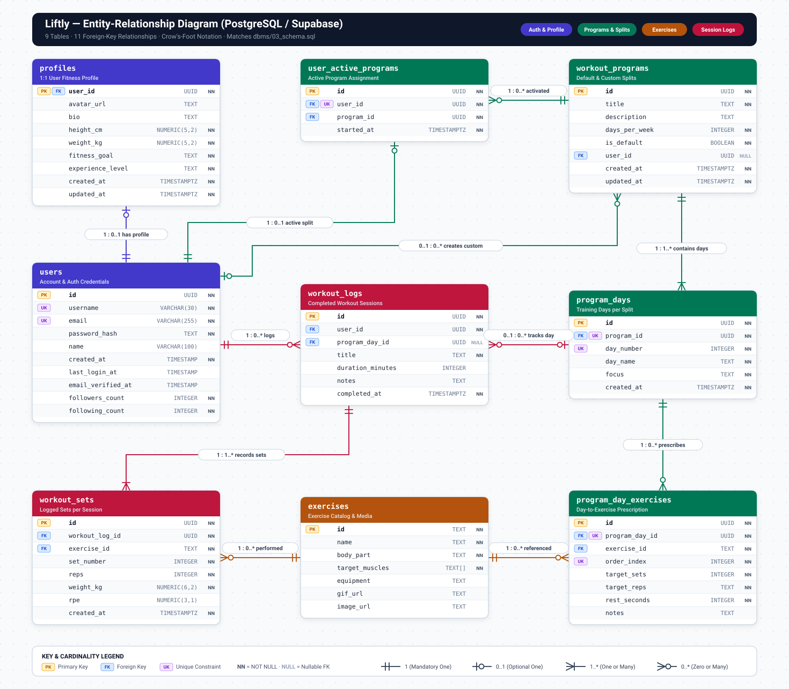
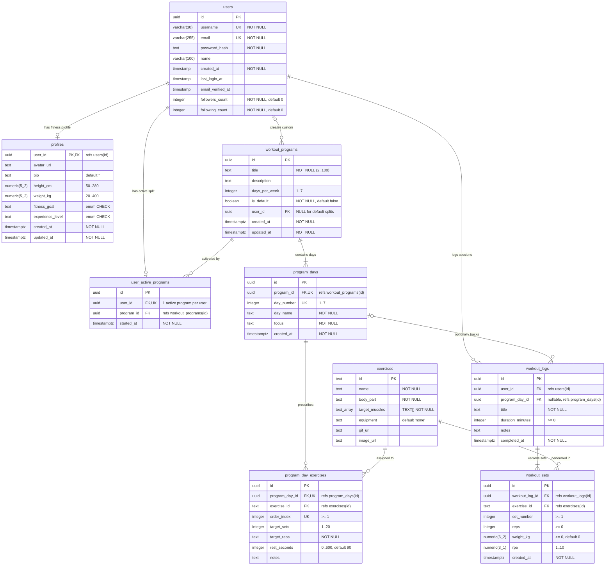

# Liftly — Entity-Relationship (ER) Diagram

This document describes the relational data model for **Liftly**, covering all 9 PostgreSQL/Supabase tables defined in [`dbms/03_schema.sql`](./03_schema.sql).

---

## 1. Visual ER Diagram (SVG)

---

## 2. Mermaid ER Diagram

---

## 3. Entity Summary

| # | Table | Domain | Primary Key | Purpose |
|---|---|---|---|---|
| 1 | `users` | Auth & Profile | `id (UUID)` | Core account credentials, identity, and cached social counters |
| 2 | `profiles` | Auth & Profile | `user_id (UUID)` | 1:1 fitness profile (biometrics, goal, experience level, avatar, bio) |
| 3 | `exercises` | Exercise Catalog | `id (TEXT)` | Shared library of exercises with `TEXT[]` target muscles and ImageKit media URLs |
| 4 | `workout_programs` | Programs & Splits | `id (UUID)` | Default library splits (`is_default = true`, `user_id IS NULL`) and user-owned custom splits |
| 5 | `program_days` | Programs & Splits | `id (UUID)` | Individual ordered training days (e.g., Push, Pull, Legs) belonging to a program |
| 6 | `program_day_exercises` | Programs & Splits | `id (UUID)` | Associative table mapping exercises onto a program day with sets, reps, rest, and order |
| 7 | `user_active_programs` | Programs & Splits | `id (UUID)` | Tracks the single currently active program per user and its `started_at` date |
| 8 | `workout_logs` | Session Logging | `id (UUID)` | Header record for a completed workout session (optionally linked to a `program_day`) |
| 9 | `workout_sets` | Session Logging | `id (UUID)` | Individual logged sets (reps, weight, RPE) for exercises performed in a session |

---

## 4. Relationships & Referential Integrity

| Parent Entity | Child Entity | Cardinality | Foreign Key | `ON DELETE` Rule | Meaning |
|---|---|---|---|---|---|
| `users` | `profiles` | `1 : 0..1` | `profiles.user_id` (PK + FK) | `CASCADE` | Identifying 1:1 profile; optional until onboarding completes (e.g., OAuth signup) |
| `users` | `workout_programs` | `0..1 : 0..*` | `workout_programs.user_id` | `CASCADE` | Custom programs belong to a user; default library programs have `user_id = NULL` |
| `users` | `user_active_programs` | `1 : 0..1` | `user_active_programs.user_id` (UNIQUE) | `CASCADE` | Each user can have at most one active program at a time |
| `workout_programs` | `user_active_programs` | `1 : 0..*` | `user_active_programs.program_id` | `CASCADE` | Many users can activate the same workout program |
| `workout_programs` | `program_days` | `1 : 1..*` | `program_days.program_id` | `CASCADE` | A program consists of 1–7 unique training days (`UNIQUE(program_id, day_number)`) |
| `program_days` | `program_day_exercises` | `1 : 0..*` | `program_day_exercises.program_day_id` | `CASCADE` | Each training day contains an ordered sequence of prescribed exercises |
| `exercises` | `program_day_exercises` | `1 : 0..*` | `program_day_exercises.exercise_id` | `RESTRICT` | Prevents deleting an exercise that is still prescribed in any program |
| `users` | `workout_logs` | `1 : 0..*` | `workout_logs.user_id` | `CASCADE` | A user records zero or more completed workout sessions over time |
| `program_days` | `workout_logs` | `0..1 : 0..*` | `workout_logs.program_day_id` | `SET NULL` | Sessions may follow a program day or be ad-hoc; history is preserved if the program is deleted |
| `workout_logs` | `workout_sets` | `1 : 1..*` | `workout_sets.workout_log_id` | `CASCADE` | Each logged session contains one or more performed sets |
| `exercises` | `workout_sets` | `1 : 0..*` | `workout_sets.exercise_id` | `RESTRICT` | Preserves historical workout set integrity by blocking deletion of referenced exercises |

---

## 5. Key Schema Design Notes

1. **Identifying 1:1 Relationship (`users` ↔ `profiles`)**: `profiles.user_id` serves as both the primary key and the foreign key referencing `users(id)`. This structurally guarantees at most one profile per user.
2. **Default vs. Custom Programs (`workout_programs.user_id`)**: Making `user_id` nullable allows built-in library programs (`is_default = true`, `user_id = NULL`) and user-created custom programs (`is_default = false`, `user_id = <uuid>`) to share one unified table.
3. **Associative Entity (`program_day_exercises`)**: Resolves the many-to-many relationship between `program_days` and `exercises` while storing prescription metadata (`order_index`, `target_sets`, `target_reps`, `rest_seconds`, `notes`).
4. **History Preservation (`ON DELETE SET NULL` & `ON DELETE RESTRICT`)**: Deleting a workout program cascades to `program_days` and sets `workout_logs.program_day_id` to `NULL` so past workout logs remain intact; `ON DELETE RESTRICT` on `exercises` prevents orphaned references in programs or logged sets.
5. **PostgreSQL Array Exception (`exercises.target_muscles`)**: Stored as `TEXT[]` with a GIN index (`idx_exercises_target_muscles`) for fast containment queries (`@>`), as documented in [`dbms/01_normalization.md`](./01_normalization.md).
